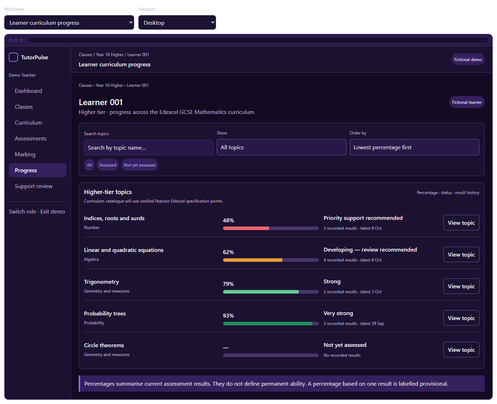
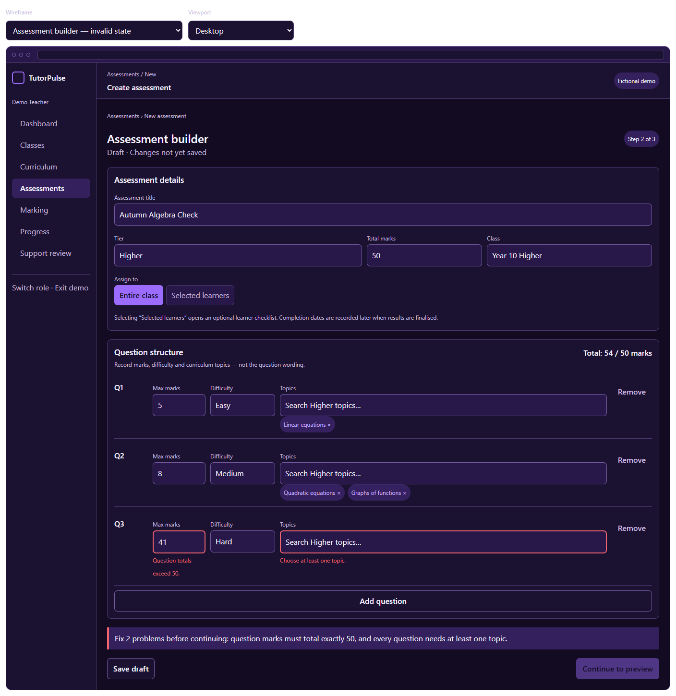
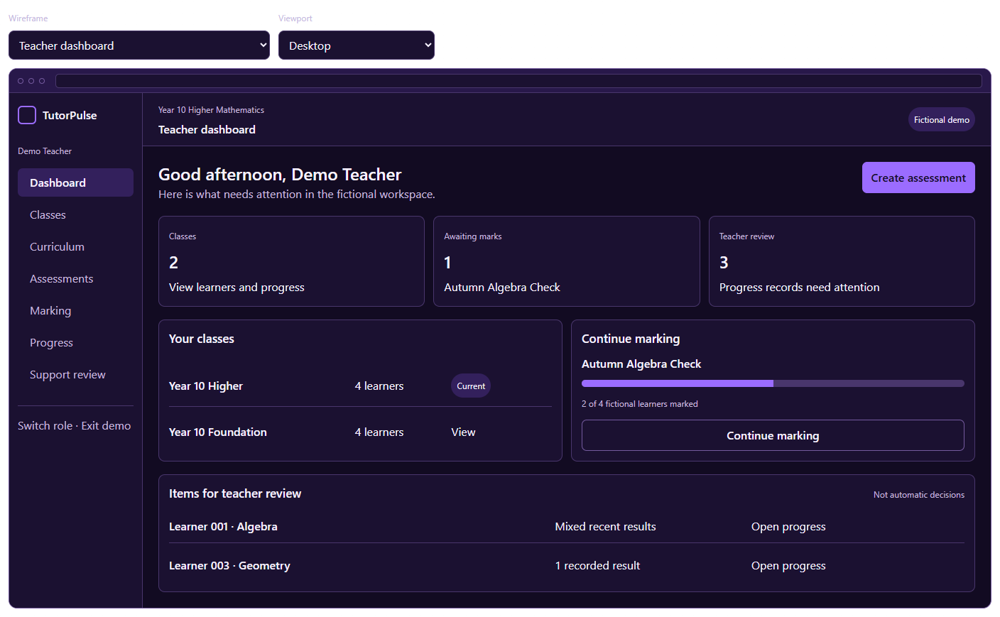

# TutorPulse Stage 9 Wireframes

These files preserve the approved Phase 2 wireframes created during Stage 9.

## Files

- `tutorpulse-stage-9-wireframes.html` is the standalone interactive review version. Open it in a browser and use the **Wireframe** and **Viewport** selectors.
- `tutorpulse-stage-9-wireframes.fragment.html` is the editable source used to create the standalone version.
- `images/` contains GitHub-friendly previews of every designed screen.

## Approved screen set

1. Public landing page
2. Teacher dashboard
3. Teacher class detail
4. Learner curriculum progress
5. Learner topic detail
6. Assessment builder invalid state
7. Partially complete marking workflow
8. Student progress
9. Loading, empty, unavailable and forbidden states

The images are planning evidence, not implemented application screenshots. Example learner names, marks, percentages and dates are fictional.

## Key previews

### Learner curriculum progress

### Assessment builder

### Teacher dashboard

## Source of truth

Product decisions represented by these wireframes are recorded in `../phase-2-wireframe-decisions.md`. If a later design changes, update the decision record, editable source, standalone file and affected images together.
